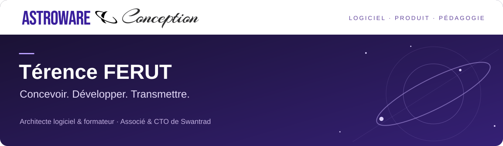

  

  <a href="https://www.astroware-conception.com/"><strong>AstroWare Conception</strong></a> ·
  <a href="https://www.linkedin.com/in/terence-ferut/">LinkedIn</a> ·
  <a href="#du-code-à-explorer">Code &amp; démonstrations</a> ·
  <a href="#construisons-la-suite">Échanger</a>

# Térence FERUT · Architecte logiciel & formateur

Je conçois des **applications métier**, je développe des **produits numériques** et j’accompagne celles et ceux qui apprennent à les construire. Mon fil conducteur : comprendre le besoin, rendre les choix techniques explicables et faire évoluer le logiciel avec ses usages.

Fondateur d’**AstroWare Conception** depuis 2011, **associé et CTO de Swantrad**, je suis également **référent de la filière informatique à Ynov Sophia Antipolis**. Je relie ces activités par la pratique : les questions rencontrées dans les produits nourrissent mes enseignements, et la pédagogie m’oblige à clarifier mes choix de conception.

**Sur ce GitHub :** des applications, des expérimentations et des supports de formation. Pour mon parcours et mes expériences détaillées, retrouvez-moi sur [LinkedIn](https://www.linkedin.com/in/terence-ferut/).

## Du code à explorer

### CPCéleste · Un atelier moderne pour l’Amstrad CPC

Un environnement de création en BASIC qui rapproche rétro-informatique et outils actuels : édition, exécution, projets multifichiers, intégration Git/GitHub et assistance par IA.

**Ce que j’y travaille :** l’outillage développeur, l’expérience d’édition et le lien entre création, exécution et qualité du code. Une application desktop **en alpha**, avec des versions de prévisualisation pour Windows et Linux.

[**Explorer le code →**](https://github.com/AstrowareConception/Micro-IDE-Amstrad) · [Guide illustré](https://github.com/AstrowareConception/Micro-IDE-Amstrad/blob/main/docs/guide-utilisateur.md) · [Versions disponibles](https://github.com/AstrowareConception/Micro-IDE-Amstrad/releases)

### VéloQuest · Transformer la régularité en progression

Une application web progressive de vélo d’intérieur : séances guidées, parcours, carnet de progression et gamification. Le suivi fonctionne en local ; la connexion Bluetooth dépend de l’équipement et du navigateur.

**Ce que j’y travaille :** une expérience produit complète en **Next.js, React et TypeScript**, la persistance des données et l’interaction avec des équipements connectés.

[**Essayer l’application →**](https://programme-velo.vercel.app/) · [Code source](https://github.com/AstrowareConception/Programme-velo) · [Présentation illustrée](https://github.com/AstrowareConception/Programme-velo/blob/main/docs/PRESENTATION.md)

### FormaFlow Core · Apprendre à justifier une architecture

Un fil rouge pédagogique pour passer d’un code volontairement imparfait à une architecture hexagonale : domaine, ports, adaptateurs, invariants et tests. **TypeScript, NestJS, PostgreSQL et Jest** servent la démonstration.

**Ce que je transmets :** isoler les règles métier, refactorer sans casser le comportement et savoir quand un pattern apporte réellement quelque chose. FormaFlow Core est un support de formation distinct du produit FormaWare.

[**Explorer le parcours et le code →**](https://github.com/AstrowareConception/ynov-b3-formaflow-hexagonal)

## Des produits ancrés dans des usages

Je développe et fais évoluer plusieurs projets au croisement du logiciel, de la formation et de la création. Les liens ci-dessous permettent de découvrir leur univers ; ils ne signifient pas que leur code est public.

| Projet | Besoin traité et contribution |
| :--- | :--- |
| [**Swantrad**](https://www.swantrad.com/) | Une plateforme pour les traducteurs, interprètes et leurs clients. **Associé & CTO**, je contribue à la direction technique, à l’architecture et au développement du produit. |
| [**FormaWare**](https://formaware.fr/) | Un outil métier pour l’activité des formateurs : missions, sessions et gestion administrative. **Conception et développement.** |
| [**IronSkill Academy**](https://ironskill.academy/) | Un projet de formation tech qui relie apprentissage, pratique et progression. **Développement et conception pédagogique.** |
| [**Crossroads Studio**](https://www.crossroads-studio.fr/) | Un environnement de création de récits interactifs : scénarios à embranchements, organisation visuelle et assistance à l’écriture. **Conception et développement.** |
| [**COMPAS**](https://app.compas.astroware-conception.com/) | Relier missions, livrables, preuves et compétences pour accompagner la progression. **Conception, développement et encadrement de stagiaires.** |
| [**Hack-me.fr**](https://hack-me.fr/) | Un projet pédagogique de sensibilisation à la sécurité applicative par la pratique. **Développement et pédagogie.** |

## Concevoir, construire, transmettre

| Architecture logicielle | Développement de produits | Formation & accompagnement |
| :--- | :--- | :--- |
| Modélisation métier, DDD, architecture hexagonale, séparation des responsabilités. | Applications web, outils métier, API, expérience utilisateur et évolution fonctionnelle. | Cours, ateliers, projets fil rouge, mentorat, évaluation et encadrement de stagiaires. |
| Rendre les décisions compréhensibles et le code testable. | Partir d’un usage concret et livrer une réponse qui peut évoluer. | Faire pratiquer, donner du retour et développer l’autonomie. |

**Technologies et sujets présents dans mes projets ou mes enseignements :**

- **Langages :** TypeScript, JavaScript, PHP, Java, Python, SQL.
- **Web & données :** React, Next.js, NestJS, API REST, PostgreSQL.
- **Conception & qualité :** DDD, architecture hexagonale, UML, tests automatisés, sécurité applicative.
- **Pratiques :** Git/GitHub, revue de code, documentation, conduite de projets et usages de l’IA dans le développement.

## La transmission fait partie du métier

- **Ynov Sophia Antipolis** — référent de la filière informatique et intervenant : développement, architecture et accompagnement de projets.
- **ISCOD** — learning coach, concepteur de contenus pédagogiques (**MOOC, études de cas, sujets d’examen**), correcteur et membre de jury.
- **CESI Nice** — interventions en **2024–2025 et 2025–2026**.
- **OpenClassrooms** — mentorat et évaluation de projets.

Au sein d’AstroWare Conception, j’accueille et j’encadre également des **stagiaires sur des projets concrets** : comprendre une mission, découper le travail, construire, documenter et démontrer ce qui a été appris.

> Mon objectif : des développeurs capables d’expliquer leurs choix, de collaborer et de faire progresser un produit.

## Construisons la suite

Un projet d’application métier, un besoin d’architecture, une formation ou un partenariat pédagogique ? Parlons du besoin, du contexte et de la prochaine étape utile.

**[Découvrir AstroWare Conception →](https://www.astroware-conception.com/)** · **[Me contacter sur LinkedIn →](https://www.linkedin.com/in/terence-ferut/)**

<strong>English · Software architecture, product development & education</strong>

I’m **Térence FERUT**, founder of **AstroWare Conception**, partner and CTO at **Swantrad**, and an IT programme lead and educator at **Ynov Sophia Antipolis**, France.

I design business applications, build digital products and mentor developers. My work connects domain-driven design, hexagonal architecture, practical software engineering and project-based learning. Explore **CPCéleste** for developer tooling, **VéloQuest** for a Next.js/React product, and **FormaFlow Core** for architecture through working code.

For professional enquiries and collaborations, connect with me on [LinkedIn](https://www.linkedin.com/in/terence-ferut/) or visit [AstroWare Conception](https://www.astroware-conception.com/).

